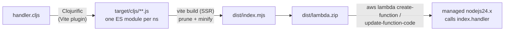

# lambda-mvp-cljrfc: ClojureScript via Clojurific on AWS Lambda

A [ClojureScript](https://clojurescript.org) handler on AWS Lambda's managed
`nodejs24.x` runtime, compiled by
[Clojurific](https://github.com/WhimsicalCode/clojurific) instead of
shadow-cljs. Clojurific is a ClojureScript fork that emits one ES module per
namespace and hands bundling to [Vite](https://vite.dev), with no Closure
Compiler anywhere in the build.

This is the sixth project in the `lambda-mvp-*` family and a twin of
[lambda-mvp-cljs](https://github.com/b12n-oss/lambda-mvp-cljs): same handler,
same runtime, same deploy and bench scripts. Only the compiler changes, so the
two make the cleanest single-variable comparison in the family.

## Status

Early release. Pin a commit if you depend on current behavior.

## How it works



- `src/main/net/b12n/lambda_mvp/handler.cljs` is the demo handler: a
  greeting, the raw event echoed back, and a warm-invocation counter, in the
  same `message`/`runtime`/`request_id`/`warm_invocation`/`event` shape as
  every sibling.
- `vite.config.mjs` holds the whole build. A `:js-entries` module exports the
  handler var as `handler`, and Vite bundles it into one self-contained
  `dist/index.mjs`, so the zip carries no `node_modules`.
- `script/aws_lifecycle.clj` does create-or-update, invoke and teardown with
  whatever the `aws` CLI already has configured.
- `script/bench_run.clj` and `script/bench.clj` run the cold/warm benchmark,
  with the parser shared across the family.

[docs/guide/clojurific-build.md](docs/guide/clojurific-build.md) walks
through the build, and why `(.-awsRequestId context)` works here when
lambda-mvp-cljs has to use `unchecked-get`.

## Requirements

- Node.js 20 or later (tested with v24.8.0) and `npm`.
- Java 17 or later. Clojurific's compiler runs on the JVM, and its `cljf`
  launcher (which the Vite plugin starts) downloads the compiler from Clojars
  on the first build. You don't need the Clojure CLI. If you have no Java,
  `npx cljf setup-java` installs one.
- `zip`, [babashka](https://babashka.org), and AWS CLI v2.
- An AWS account the `aws` CLI can already use (`AWS_PROFILE`/`AWS_REGION`,
  or `aws configure`). Nothing in this repo hardcodes a profile, account or
  region.

## Quickstart

```sh
bb build       # Clojurific + vite build -> dist/index.mjs -> dist/lambda.zip
bb smoke       # local smoke: call the bundled handler twice, no AWS
bb test        # script/bench.clj's unit tests
bb verify      # test + build + smoke, what CI runs
bb demo        # build + deploy + invoke, prerequisites checked first
bb deploy      # idempotent: IAM role + Lambda function, create or update
bb invoke      # one ad-hoc invoke, prints the response and REPORT line
bb bench       # cold/warm boot-time comparison across memory tiers
bb teardown    # delete the function and role
bb clean       # remove build artifacts
```

The function is `lambda-mvp-cljrfc` and its role `lambda-mvp-cljrfc-role`;
`LAMBDA_MVP_FUNCTION_NAME` overrides both. It deploys to `arm64` by default,
and `LAMBDA_ARCH=x86_64` switches it.

## Cold vs. warm boot

Measured on 2026-11-14 alongside lambda-mvp-cljs, same account, region and
hour, median of three runs at 2048 MB:

| | shadow-cljs | Clojurific |
|---|---|---|
| Cold Init Duration | 134.7 ms | 184.4 ms |
| Cold Duration | 4.9 ms | 3.4 ms |
| Warm Duration | 1.8 ms | 1.8 ms |
| Max Memory Used | 77 MB | 81 MB |
| Deployed zip | 23 KB | 77 KB |

Clojurific's bundle is about three times larger, which costs it 15-50 ms of
Init, while the handler's first call runs about a third faster. See
[docs/guide/cold-warm-boot.md](docs/guide/cold-warm-boot.md) for both memory
tiers, the ranges, and what the numbers can and can't tell you.

## References

- [Clojurific](https://github.com/WhimsicalCode/clojurific), the compiler.
- [lambda-mvp-cljs](https://github.com/b12n-oss/lambda-mvp-cljs), the
  shadow-cljs twin this project is measured against.
- The rest of the family:
  [lambda-mvp-jlt](https://github.com/b12n-oss/lambda-mvp-jlt) (Jolt),
  [lambda-mvp-jnk](https://github.com/b12n-oss/lambda-mvp-jnk) (jank),
  [lambda-mvp-bb](https://github.com/b12n-oss/lambda-mvp-bb) (Babashka) and
  [lambda-mvp-rst](https://github.com/b12n-oss/lambda-mvp-rst) (Jolt with
  Rust). lambda-mvp-bb's
  [five-way comparison](https://github.com/b12n-oss/lambda-mvp-bb/blob/main/docs/guide/five-way-comparison.md)
  puts them side by side.

## License

EPL 2.0, see `LICENSE`.
